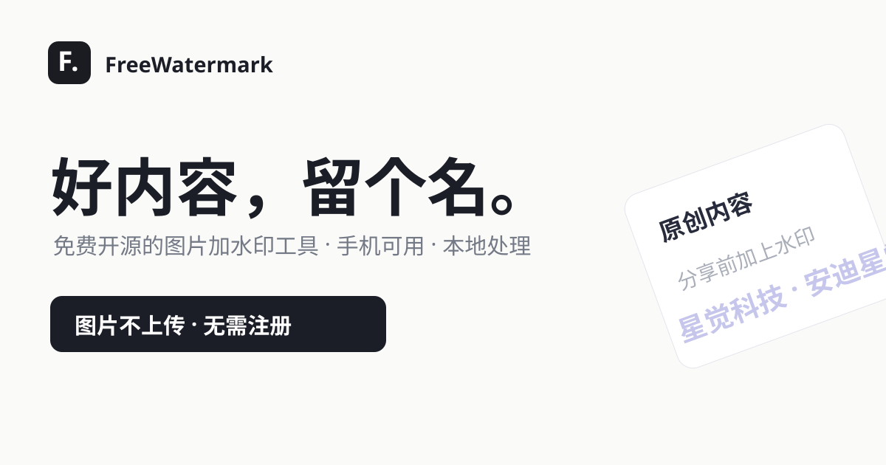

<div align="center">

# FreeWatermark ✳

### 好内容，留个名。

**免费开源的图片加水印工具 · 手机直接用 · 浏览器本地处理 · 无需注册**

  

[🌐 打开网站](https://aipmandy.github.io/FreeRedact/FreeWatermark/) · [🛠 在线源码](https://github.com/AIPMAndy/FreeRedact/tree/main/FreeWatermark) · [👨‍💻 作者 GitHub](https://github.com/AIPMAndy)

</div>

> 仓库状态：当前版本先以**独立源代码目录**的形式发布于 `AIPMAndy/FreeRedact/FreeWatermark`，采用独立 MIT 许可、独立代码和独立部署工作流。GitHub 连接目前不支持创建新仓库，因此**尚未建立独立 `AIPMAndy/FreeWatermark` 仓库**。目录可原样迁出作为独立仓库；网页使用现有 GitHub Pages 路径。上方在线链接须以实际 Pages 部署成功为准。



## 为什么做它

日常发布截图、公众号配图、Threads 和小红书内容时，只想在图片上写上品牌名字，却经常要打开复杂的软件或者购买会员。FreeWatermark 专注解决这一件事：**选图 → 选品牌 → 保存**。

## 已实现功能

- ✳ **品牌快捷预设**：`星觉科技`、`安迪星觉`、`AI 酋长 Andy`、任意自定义文字（最多 64 字符）。
- 🖼️ **自定义 Logo**：可上传 PNG、JPG、WebP，建议透明 PNG。
- 🎛️ **四种样式**：满屏平铺、右下角署名、底部品牌条、自由拖动。
- 🎚️ **调整参数**：透明度、大小、平铺密度、倾斜角度、字体颜色。
- 📱 **移动端**：手机相册选图、触控移动水印、PNG/JPG/WebP 导出、系统分享（浏览器支持时）。
- 📦 **批量处理**：最多 12 张图共用一套设置，批量输出 ZIP 文件。
- 🔒 **本地优先**：使用浏览器 Canvas 绘制；没有文件上传 API、后端、第三方埋点、在线字体或 CDN。
- 🏠 **基础 PWA**：网站加载后，部分浏览器支持添加到主屏幕，静态资源可离线使用。
- 🧪 **开源质量验证**：Node 单测 + Chromium 移动端回归；详见 `tests/`。

## 使用方法

**手机**：浏览器打开在线工具，点击「上传一张截图」→ 选取相册图片 → 选择「星觉科技」等预设 → 调整参数 → 点击「下载图片」或「手机分享 / 保存」。如果 iOS 浏览器没有直接存入相册，请从系统分享菜单选择保存到照片/文件；不同 Safari 版本支持情况可能不同。

**电脑**：支持选择文件、拖入图片、粘贴剪贴板中的图片；自由拖动模式可用鼠标定位。

**批量**：一次选择 2–12 张图片，调整水印后点击「批量打包 ZIP」。iPhone 上可以在「文件」App 中解压。

## 本地运行

```bash
git clone https://github.com/AIPMAndy/FreeRedact.git
cd FreeRedact/FreeWatermark
python3 -m http.server 8080
```

访问 `http://localhost:8080/`。无构建步骤、无 npm 运行时依赖。若源代码已经迁移到独立仓库，把路径替换为 `FreeWatermark` 即可。

## 测试

```bash
npm test
python3 -m pip install playwright pillow
python3 -m playwright install chromium
python3 tests/browser_smoke.py
```

浏览器回归验证：真实像素被叠加水印、原图尺寸、导出 PNG、批量 ZIP、手机视口布局和本地隐私边界。Chromium 手机模拟并不等于 iOS Safari 真机测试。

## GitHub Pages 部署

目录内自带 `.github/workflows/pages.yml`，迁入独立公开仓库根目录即可直接部署。首次使用时在 Settings → Pages 中选择 `GitHub Actions`；工作流通过且网页 HTTP 200 才能视为上线完成。

本次临时托管路径是 `FreeRedact/FreeWatermark/`：由 FreeRedact 的 Pages 工作流把该目录作为静态资源拷贝到发布产物里。项目代码与 FreeRedact 的功能代码相互隔离。

## 安全、隐私与限制

- 所选图片、Logo 不通过工具上传服务器；图片处理在本机 Canvas 完成。GitHub Pages 作为网站托管平台可能保留普通页面请求日志。
- 输出图像经过重新编码，水印合成进像素，通常不包含原图的 EXIF/GPS 等原生元数据；仍应在公开前人工检查隐私内容。
- 对浏览器无法解码的 HEIC/AVIF，请先转为 PNG/JPG；对超大图片可能出现内存限制。限制：单张 30MB、总 90MB、最长边 8500px、3200 万像素。
- ZIP 采用无压缩 STORE 标准，压缩包可能较大。移动浏览器下载文件或批量导出行为因设备、权限与浏览器而异。
- **本项目不是去水印工具**；请对你拥有授权的内容添加水印，尊重原作者的版权。

## 技术结构

```text
FreeWatermark/
├─ index.html                 # 中文响应式工具页
├─ styles.css                 # 移动优先 UI
├─ src/engine.js              # 纯 Canvas 水印引擎
├─ src/app.js                 # 上传、状态、预览、保存
├─ src/zip.js                 # 无依赖 ZIP 打包
├─ sw.js / manifest.webmanifest
├─ .github/workflows/pages.yml
├─ tests/                     # 单测与浏览器回归
└─ LICENSE                    # MIT
```

## 关于作者

**AI 酋长 Andy** · 星觉科技。前腾讯、百度 AI 产品专家，前大模型公司 VP，专注 AI 产品化与业务增长。

- 官网：[metaver.vip](https://metaver.vip/)
- GitHub：[AIPMAndy](https://github.com/AIPMAndy)
- 微信：`AIPMAndy`（备注「FreeWatermark」）
- 更多工具：[FreeRedact](https://github.com/AIPMAndy/FreeRedact) · [FreeCover](https://github.com/AIPMAndy/FreeCover) · [FreePhoto](https://github.com/AIPMAndy/FreePhoto)

欢迎 Star / Fork / PR。项目基于 MIT License 公开，免费使用及二次开发。